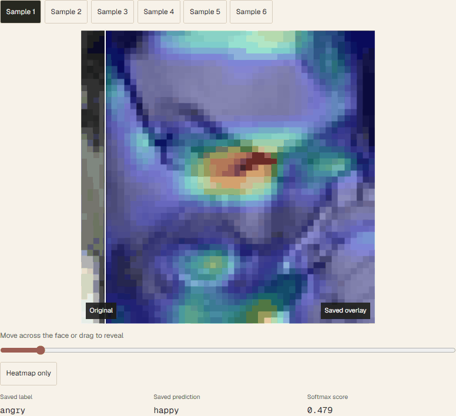

# CSCI 5527 Project

<!-- BEGIN portfolio-project-animations -->
## Recorded project interactions

These previews record interaction with original project figures, saved notebook outputs, source tests, or the actual project interface. They do not represent new experiments, model inference, or benchmark runs. Pointer-driven inspection, saved-result selection, and browser controls are captured below.

### Reveal the saved Grad-CAM



Original notebook images, matched by sample. Includes wrong predictions and flat heatmaps. Scores are saved softmax values, not calibrated confidence or a new model run.

[Original project material](https://github.com/RohitPoduval1/csci5527-project/blob/ec8922cbc88ded815884922efd95321e2947d522/vanillaCNN/vanillaCNN_baseline.ipynb)

<!-- END portfolio-project-animations -->

## Colab Instructions

### Getting the Data
To use the FER2013 data:
```python
import kagglehub

path = kagglehub.dataset_download("msambare/fer2013")
print("Path to dataset files:", path)
```

### Using `dataset.py`

In Colab, run the following:
```bash
!git clone https://github.com/RohitPoduval1/csci5527-project.git
```

```python
import sys

sys.path.append('/content/csci5527-project')

# Import FERDataset and use like a normal Dataset
from fer_dataset import FERDataset
```
